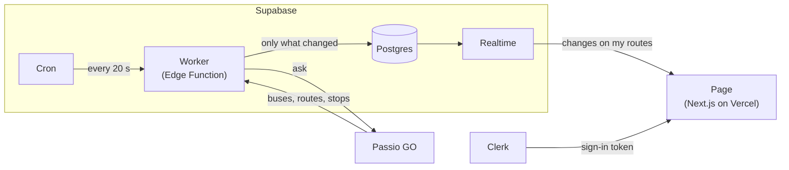

# UChicago Shuttles Live

Follow the UChicago shuttle routes you ride and watch their buses move on a map, live, without refreshing.

**Live site:** https://passio-live.vercel.app

## How it works



- Every 20 seconds, a worker asks Passio GO where UChicago's buses are and saves only what changed.
- Supabase Realtime pushes those changes to each signed-in page, but only for the routes that person follows.
- Row-level security keeps each person's followed routes private.

**Built with:** Next.js, Tailwind, Clerk, Supabase (Postgres, Realtime, Edge Functions, Cron), Leaflet with OpenStreetMap, on Vercel.

## Run it locally

```bash
npm install
npm run dev        # http://localhost:3000
npm run test:page && npm run test:worker
```

It needs a `.env.local` (never committed) with `NEXT_PUBLIC_CLERK_PUBLISHABLE_KEY`, `CLERK_SECRET_KEY`, `NEXT_PUBLIC_SUPABASE_URL` and `NEXT_PUBLIC_SUPABASE_PUBLISHABLE_KEY`, plus `NEXT_PUBLIC_CLERK_SIGN_IN_URL=/sign-in` and `NEXT_PUBLIC_CLERK_SIGN_UP_URL=/sign-up`.

The full data-flow plan is in [`docs/data-flow.md`](docs/data-flow.md), and the step-by-step build log is in [`process-log.md`](process-log.md).

Bus data from [Passio GO](https://passiogo.com). Map © [OpenStreetMap](https://www.openstreetmap.org/copyright) contributors.
