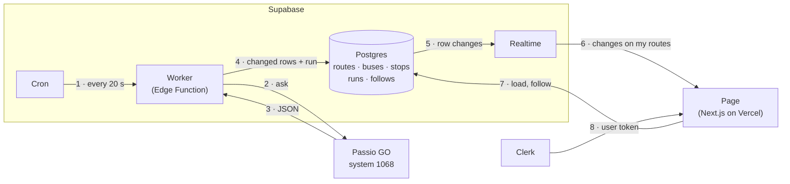

# UChicago Shuttles Live

Follow the UChicago shuttle routes you ride and watch their buses move on a map, live, without refreshing.

**Live site:** https://passio-live.vercel.app

- Sign in, pick your routes, and see only those buses.
- Buses update about every 20 seconds, pushed to the page as they change.
- A status line says whether the data is **Live**, **Behind**, or **Not live**.
- Stops on your routes show on the map, with the stop's name on hover.
- What you follow is private to your account.

## How it works



1. **Supabase Cron** starts the worker every 20 seconds.
2. **The worker** asks Passio GO (the bus company's tracking service) for every UChicago bus. It fetches routes every 5 minutes and stops every hour.
3. It cleans up Passio's data (text to numbers, CTA buses and routes left out) and compares it with what's saved.
4. It writes **only what changed**, plus one row in `runs` recording that the run happened.
5. **Realtime** sees each change to `buses` and `runs`.
6. It sends bus changes only to signed-in pages that follow that bus's route, and each new run to every signed-in page. It checks row-level security with the person's Clerk token first.
7. **The page** moves the dot on the map and updates "Live · updated 4 s ago".

Vercel only serves the page's code. Live updates never pass through it. A bus on the map can be up to about 20 seconds behind Passio, plus whatever delay Passio has.

## Stack

| Part | Tool | Job |
|---|---|---|
| Page | Next.js 16 (App Router), React 19, Tailwind 4, on Vercel Hobby | The site |
| Sign-in | Clerk | Accounts and the token the database checks |
| Database | Supabase Postgres, with row-level security | Routes, buses, stops, runs, follows |
| Live updates | Supabase Realtime | Pushes row changes to open pages |
| Worker | Supabase Edge Function (Deno), run by Supabase Cron | Polls Passio and saves what changed |
| Map | Leaflet with OpenStreetMap tiles | Buses, stops, attribution |
| Data source | Passio GO, UChicago system 1068 (no key) | Buses, routes, stops |

## Data

| Table | One row per | Written by |
|---|---|---|
| `routes` | UChicago route (20), with color and whether it's running | Worker, every 5 min |
| `buses` | Shuttle, with position, heading, route and last GPS time | Worker, every 20 s, only if it changed |
| `stops` | Stop (95), with the routes that stop there | Worker, every hour |
| `runs` | Worker run, with its time, counts and any error | Worker, every 20 s |
| `follows` | Person and route they follow | The page, as that person |

Key choices (details and reasons are in [`docs/data-flow.md`](docs/data-flow.md)):

- **A bus is written only when it really changed.** That means it moved 10 m or more, has a new GPS time, changed route or service status, or joined or left the feed. GPS jitter on a parked bus doesn't count.
- **Freshness comes from `runs`, not from bus rows.** A parked bus isn't rewritten, so only the run log proves the feed is still alive.
- **A bus that leaves the feed is marked, not deleted.** Realtime can filter updates by route, but not deletes.
- **Missing data is treated with caution.** The worker waits for 3 empty bus lists in a row before marking every bus gone. A route missing from a stop fetch keeps its stops.
- **Old logs are trimmed.** A daily job keeps 7 days of `runs` and 1 day of the cron history.

### How fresh the page is

| Status | When |
|---|---|
| Connecting… | Before the first load |
| **Live** (green) | The last good run was 60 s ago or less |
| **Behind** (amber) | 2 runs in a row missed (over 60 s), or the connection dropped under 15 s ago |
| **Not live** (red) | No good run in 5 minutes, or the connection has been down 15 s or more |

A bus whose GPS time hasn't changed in 3 minutes is drawn faded and listed as "GPS not updating".

## Security

- **Keys** live only in `.env.local` (not committed) and in platform settings (Vercel and Supabase). Never in code.
- **The browser** uses Supabase's publishable key plus the person's Clerk token.
- **The worker** uses the secret key, which Supabase gives it on its own servers. Its URL turns away any caller without a secret key. Cron sends one stored in Supabase Vault.
- **Row-level security** is on for every table:
  - `follows`: each person can read, add and remove only their own rows (`user_id = auth.jwt()->>'sub'`).
  - `routes`, `buses`, `stops`, `runs`: readable only when signed in. Only the worker writes them.

## Project layout

```
app/
  page.tsx, home.tsx        Landing page, or the tracker once signed in
  live-tracker.tsx          Follows, the Realtime subscription, the status line, the bus list
  bus-map.tsx               The Leaflet map: buses and stops
  lib/live.ts               Page rules: freshness, merging updates, stops on my routes (tested)
  lib/supabase-browser.ts   Supabase client that sends the Clerk token
  sign-in/, sign-up/        Clerk pages
supabase/
  functions/worker/         The worker: index.ts (network and database), lib.ts (rules, tested)
  migrations/               Tables, policies, Realtime, cron schedules
docs/
  data-flow.md              The full data-flow plan and its choices
  tracker.html              Step-by-step progress (open in a browser)
process-log.md              What was asked, built, pushed back on and caught, step by step
```

## Run it locally

You need Node 22 or newer, plus a Clerk app and a Supabase project.

1. `npm install`
2. Create `.env.local` with these names. The values come from your Clerk and Supabase dashboards.
   ```
   NEXT_PUBLIC_CLERK_PUBLISHABLE_KEY=
   CLERK_SECRET_KEY=
   NEXT_PUBLIC_CLERK_SIGN_IN_URL=/sign-in
   NEXT_PUBLIC_CLERK_SIGN_UP_URL=/sign-up
   NEXT_PUBLIC_CLERK_SIGN_IN_FALLBACK_REDIRECT_URL=/
   NEXT_PUBLIC_CLERK_SIGN_UP_FALLBACK_REDIRECT_URL=/
   NEXT_PUBLIC_SUPABASE_URL=
   NEXT_PUBLIC_SUPABASE_PUBLISHABLE_KEY=
   ```
   On Vercel, set the same names as environment variables before building. `NEXT_PUBLIC_` values are built into the page.
3. `npm run dev`, then open http://localhost:3000.

**Checks:**

```bash
npm run test:page     # page rules (23 tests)
npm run test:worker   # worker rules, on saved Passio responses (44 tests)
npm run lint
npm run build
```

**Back end (one-time setup in your own Supabase project):**

1. Connect Clerk to Supabase: add Clerk as a third-party auth provider in Supabase, and use "Connect with Supabase" in Clerk.
2. Store a Supabase secret key in Vault under the name `worker_secret_key`.
3. Apply the files in `supabase/migrations` in order. They create the tables, policies, Realtime setup and both cron jobs. In `..._schedule_worker_every_20_seconds.sql`, change the worker URL to your own project's first.
4. Deploy the worker: `supabase functions deploy worker --no-verify-jwt`. The worker checks the key itself.

## Free plans and limits

Everything runs on free plans with no card attached, so nothing can be charged. If a limit is reached, that service pauses or restricts the app instead.

| Service | Limit that matters | Our use |
|---|---|---|
| Supabase Free | 500 MB database; 500,000 function calls, 2 million Realtime messages and 5 GB egress a month | 15 MB; about 130,000 worker calls a month |
| Vercel Hobby | 100 GB transfer and 1 million requests a month | Small; map tiles come from OpenStreetMap |
| Clerk (development instance) | 100 users | A class |
| OpenStreetMap tiles | Usage policy: visible attribution, no bulk downloading | Normal map viewing |
| Passio GO | No published limits | We set our own: every 20 s, routes every 5 min, stops hourly |

## Limits of this version

- Passio GO isn't an official public API, so its format could change without notice.
- Passio's GPS times are only to the minute, so freshness uses the worker's own clock.
- No arrival-time predictions, just positions.
- The map zooms to your buses once. Following another route later doesn't zoom again.
- Clerk's development instance allows 100 accounts. More would need a production instance, which needs a custom domain.

## How it was built

Built in seven steps with an AI coding agent (Claude Code), one step at a time, with every step directed by me. [`process-log.md`](process-log.md) records each step: what I asked, what was made, where I pushed back, and what I caught. [`docs/tracker.html`](docs/tracker.html) shows progress, and the commit history follows the same steps.

Bus data from [Passio GO](https://passiogo.com). Map © [OpenStreetMap](https://www.openstreetmap.org/copyright) contributors.
