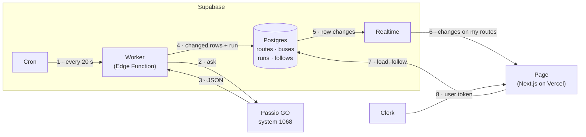

# Data flow

**Status: step 3 plan.** Decided: a bus counts as changed under [option B](#what-counts-as-a-change) with a 10 m threshold (we may tune it later). The worker fetches buses every 20 seconds and routes every 5 minutes.

## What each arrow sends

| # | From → to | What it sends |
|---|---|---|
| 1 | Cron → Worker | An HTTP request every 20 seconds that starts one run. Nothing else. |
| 2 | Worker → Passio | `POST getBuses=2` on every run, and `POST getRoutes=2` when the last route fetch was 5 or more minutes ago. Routes only change when a service starts or stops, so most runs make one Passio call instead of two. |
| 3 | Passio → Worker | Every UChicago bus (about 15 by day, 7 at night) and, every 5 minutes, all 33 routes. Raw Passio values: latitude and longitude as strings, `created` only to the minute. |
| 4 | Worker → Postgres | First the worker cleans the data: numbers instead of strings, trimmed names, true/false values, CTA routes dropped. Then it writes **only the bus and route rows that changed**, plus one `runs` row with its own fetch time and counts. It writes with the secret key, which bypasses row-level security. |
| 5 | Postgres → Realtime | Every insert and update on `buses` and `runs`, which are added to Realtime. |
| 6 | Realtime → Page | Over a websocket: bus updates filtered to `route_id=in.(my routes)`, plus each new `runs` row, for "updated 12 s ago". Realtime checks row-level security with the user's Clerk token before sending anything. |
| 7 | Page → Postgres | When the page opens, it loads active routes, my follows, the buses on my routes and the latest run. Following or unfollowing a route inserts or deletes a row in `follows`. It uses the publishable key plus the Clerk token. |
| 8 | Clerk → Page | The signed-in user's session token. Its `sub` claim (`user_…`) is the user ID the row-level security policies check. |

## What counts as a change

**Decided: B, with a 10 m threshold, which we may tune later.** Step 1 measured 75 bus-to-bus comparisons, 20 seconds apart:
- Position changed in 93% of them, heading in 87%, and Passio's GPS report time (`created`) in 39%.
- Parked buses drifted 1–4 m per call from GPS jitter.
- Bus 2207 froze: same position and same `created`, while Passio's `outdated` stayed 0.

| Option | A bus row is written when… | Effect |
|---|---|---|
| **A. Anything differs** | Any saved field is different | Simplest. Parked buses still get written on every run because of jitter, so they twitch on the map. |
| **B. Real change** (chosen) | It moved **10 m or more**, or its route, service status or GPS report time changed, or it joined or left the feed. Heading is saved with those writes but doesn't cause one by itself. | Moving buses are written on every run. Parked buses are written about once a minute, when `created` ticks, instead of three times a minute. A frozen GPS like 2207's stops being written, so its `gps_changed_at` gets older and the page can flag it. |
| **C. Movement only** | It moved 10 m or more, or its route or service status changed | Fewest writes, but a parked bus and a frozen GPS look the same: neither is written. |

A route row is written when its name, short name, color or active flag changes.

## Tables

Row-level security is on for all four tables. Only `follows` holds user data, so only `follows` has `user_id`. The worker writes `routes`, `buses` and `runs` with the secret key. Signed-in users can only read them.

**routes**: UChicago routes only. CTA routes (IDs starting with `cta`) are never saved.

| Column | Type | From Passio | Note |
|---|---|---|---|
| `id` | text, primary key | `myid` | The ID buses point to |
| `name` | text | `name` | Trimmed (`"Midway Convocation "` has a trailing space) |
| `short_name` | text | `shortName` | |
| `color` | text | `color` | |
| `active` | boolean | `outdated` | `outdated` comes as `"0"` or `0`; `active` is its opposite |
| `changed_at` | timestamptz | worker's clock | Last time any field changed |

**buses**: one row per vehicle.

| Column | Type | From Passio | Note |
|---|---|---|---|
| `device_id` | text, primary key | `deviceId` | Passio sends a number; stored as text so it can't change type |
| `name` | text | `busName` | |
| `route_id` | text | `routeId` | No foreign key (see below) |
| `route_name` | text | `route` | |
| `color` | text | `color` | |
| `lat`, `lng` | double precision | `latitude`, `longitude` | Strings converted to numbers |
| `heading` | real | `calculatedCourse` | Degrees |
| `out_of_service` | boolean | `outOfService` | |
| `passio_outdated` | boolean | `outdated` | Kept, but not trusted (bus 2207) |
| `gps_time` | text | `created` | For example `"06:16 PM"`; compared from one run to the next |
| `gps_changed_at` | timestamptz | worker's clock | When `gps_time` last changed; used for per-bus staleness |
| `in_feed` | boolean | worker | Set to false when the bus disappears from Passio |
| `changed_at` | timestamptz | worker's clock | Last write |

**follows**: one row per user per route they follow.

| Column | Type | Note |
|---|---|---|
| `user_id` | text | Clerk user ID; defaults to `auth.jwt()->>'sub'` |
| `route_id` | text | |
| `created_at` | timestamptz | |

The primary key is (`user_id`, `route_id`). Policies for select, insert and delete check `user_id = (select auth.jwt()->>'sub')`, so each person sees and changes only their own follows.

**runs**: one row per worker run, about 4,300 a day. We'll trim old rows later.

| Column | Type | Note |
|---|---|---|
| `id` | bigint identity, primary key | |
| `started_at` | timestamptz | The worker's fetch time. The page's freshness comes from this. |
| `duration_ms` | integer | |
| `ok` | boolean | |
| `buses_seen` | integer | |
| `buses_changed` | integer | |
| `routes_changed` | integer | Null on runs that don't fetch routes |
| `error` | text | Null when `ok` |

## Choices in this plan

- **Freshness comes from `runs`, not from bus rows.** Unchanged buses aren't written, so their rows can't show that the feed is still alive. Passio's own timestamps are only to the minute.
- **A bus that leaves the feed is marked, not deleted.** `in_feed = false` is an update, so Realtime can filter it by route. Realtime can't filter deletes, so every open page would receive every one.
- **Per-bus staleness uses `gps_changed_at`**, because Passio's `outdated` flag stayed 0 on a frozen bus.
- **No foreign key from `buses.route_id` to `routes`.** If a bus reported a route we haven't saved, the foreign key would make the worker's whole write fail. The page joins on the ID instead.
- **Clerk user IDs are text (`user_…`), not UUIDs.** So `follows.user_id` is text, and the policies use `auth.jwt()->>'sub'`. `auth.uid()` expects a UUID.
